# Chapter 6 — Implementing Authentications
### Revision Notes

---

## 1. The Big Picture: What Does the Authentication Layer Actually Do?

Chapters 3 and 4 covered the supporting actors of authentication: `UserDetails`, `UserDetailsService`, `UserDetailsManager`, `PasswordEncoder`, and the Spring Security crypto module (SSCM). This chapter covers the part that holds the **logic** of authentication: the `AuthenticationProvider`. It is the component the `AuthenticationManager` (chapter 5) delegates to, and the `SecurityContext` is where the result is kept.

Authentication has only **two possible outcomes**:

| Outcome | What happens |
|---|---|
| Not authenticated | User not recognized; request rejected, no authorization step. Usually HTTP **401 Unauthorized**. |
| Authenticated | Requester details are stored so the app can use them for authorization. `SecurityContext` holds the details of the current authenticated request. |

**This chapter covers:**
- Implementing authentication logic using a custom `AuthenticationProvider`
- Using the HTTP Basic and form-based login authentication methods
- Understanding and managing the `SecurityContext` component

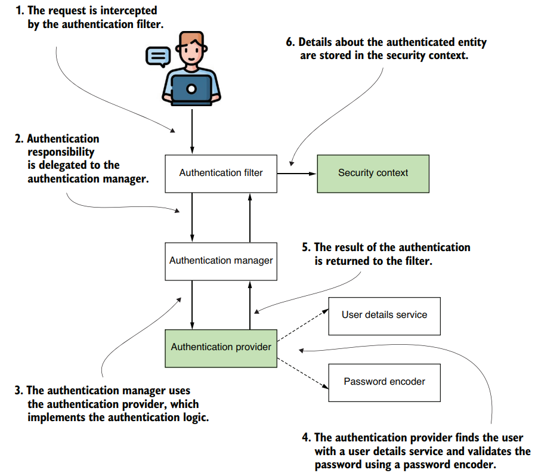
*(The authentication flow in Spring Security, with `AuthenticationProvider` and `SecurityContext` highlighted as this chapter's focus)*

**Where it leads:** this chapter covers the remaining parts of the flow (the shaded boxes in the figure). Authorization (what happens after authentication) comes in chapters 7 and 8.

**Order of the chapter:**
1. `Authentication` interface (how a request is represented)
2. Details after successful authentication → `SecurityContext` and how Spring Security manages it
3. Customizing HTTP Basic
4. Form-based login as another authentication option

---

## 2. Understanding the AuthenticationProvider

The default username/password authentication does not always fit enterprise apps. An app may need other proofs of identity:
- A code received by SMS or shown by a specific application
- A key stored in a file
- A representation of the user's fingerprint

A framework must be flexible enough to allow any of these.

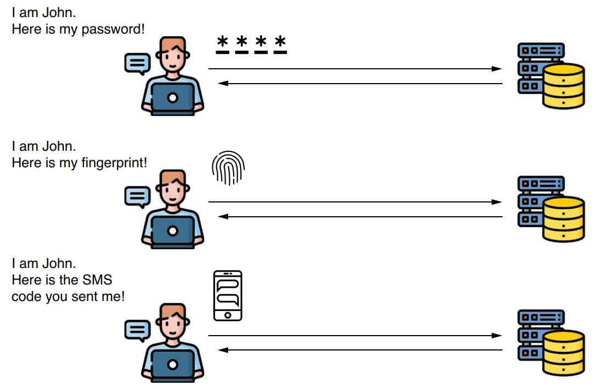
*(Different authentication methods: password, fingerprint, SMS code)*

A framework ships the most common implementations but cannot cover everything. In Spring Security, the **`AuthenticationProvider`** contract lets you define any custom authentication logic.

**Plan of this section:**
- 2.1 — how Spring Security represents the authentication event
- 2.2 — the `AuthenticationProvider` contract
- 2.3 — writing custom authentication logic (example)

---

### 2.1 Representing the Request During Authentication

To implement a custom `AuthenticationProvider`, you first need to know how the authentication event is described.

**Key definition:**
> `Authentication` is the interface representing the authentication request event; it holds the details of the entity (the **principal**) requesting access to the application.

- The details can be used **during and after** the authentication process.
- The user requesting access is called a **principal**.
- Java Security already has a `Principal` interface for the same concept, and Spring's `Authentication` **extends** it.

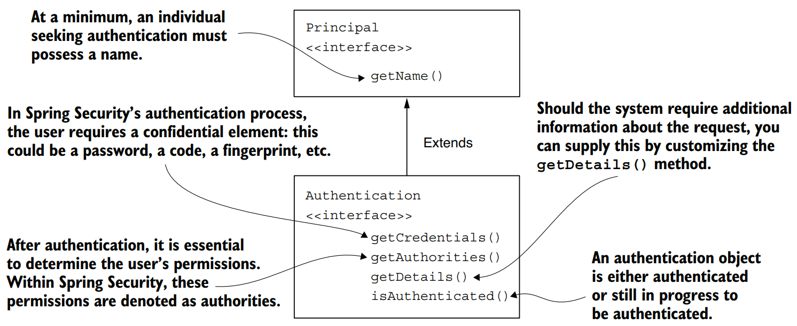
*(`Authentication` extends `Principal` and adds credentials, authorities, details, and the authenticated flag)*

| Method | Meaning |
|---|---|
| `getName()` (from `Principal`) | At a minimum, whoever seeks authentication must have a name |
| `getCredentials()` | The confidential element: password, code, fingerprint, etc. |
| `getAuthorities()` | The permissions after authentication; in Spring Security these are *authorities* |
| `getDetails()` | Supply extra information about the request by customizing this |
| `isAuthenticated()` | Authentication object is either authenticated or still in progress |

**Why extend `Principal`:** compatibility with other frameworks and apps, which makes migration to Spring Security from apps that authenticate differently easier.

```java
public interface Authentication extends Principal, Serializable {
  Collection<? extends GrantedAuthority> getAuthorities();
  Object getCredentials();
  Object getDetails();
  Object getPrincipal();
  boolean isAuthenticated();
  void setAuthenticated(boolean isAuthenticated)
    throws IllegalArgumentException;
}
```
*(Listing 6.1 — the `Authentication` interface as declared in Spring Security)*

**Methods to know for now:**
- `isAuthenticated()` — `true` if authentication ended, `false` if still in progress
- `getCredentials()` — password or any secret used in the process
- `getAuthorities()` — collection of granted authorities for the authenticated request

The other methods are discussed in later chapters, where relevant.

---

### 2.2 Implementing Custom Authentication Logic

The `AuthenticationProvider` handles the authentication logic. Its **default implementation** delegates finding the user to a `UserDetailsService` and uses the `PasswordEncoder` for password handling.

```java
public interface AuthenticationProvider {
  Authentication authenticate(Authentication authentication)
    throws AuthenticationException;
  boolean supports(Class<?> authentication);
}
```
*(Listing 6.2 — the `AuthenticationProvider` interface)*

It is tightly coupled to `Authentication`: `authenticate()` receives an `Authentication` and returns an `Authentication`.

**Rules for implementing `authenticate()`:**
- ✅ Throw `AuthenticationException` if authentication fails.
- ✅ Return `null` if it receives an `Authentication` type that your provider does not support → this allows multiple `Authentication` types separated at the HTTP-filter level.
- ✅ Return a **fully authenticated** `Authentication` on success: `isAuthenticated()` is `true` and it holds all necessary details about the entity.
- ⚠️ Usually remove sensitive data (e.g. the password) from the returned instance — it is no longer needed and keeping it risks exposing it.

**`supports(Class<?> authentication)`:**
- Return `true` if this provider supports the given `Authentication` type.
- ⚠️ Even when `supports()` returns `true`, `authenticate()` can still reject the request by returning `null`. Providers can reject based on the **details** of the request, not only its **type**.

**Analogy (door lock):** a door that opens with either a **card** or an old-fashioned **physical key**.
- The lock = the **authentication manager**; it decides whether to open.
- It delegates to two **authentication providers**: one validates cards, the other validates keys.
- Present a card → the key-only provider says it doesn't know this kind of authentication. The card provider supports it and checks validity. That is the purpose of `supports()`.
- Extra layer: the lock may recognize several kinds of cards. A provider might say "I understand this is a card, but it isn't the type I can validate" → `supports()` returns `true` but `authenticate()` returns `null`.

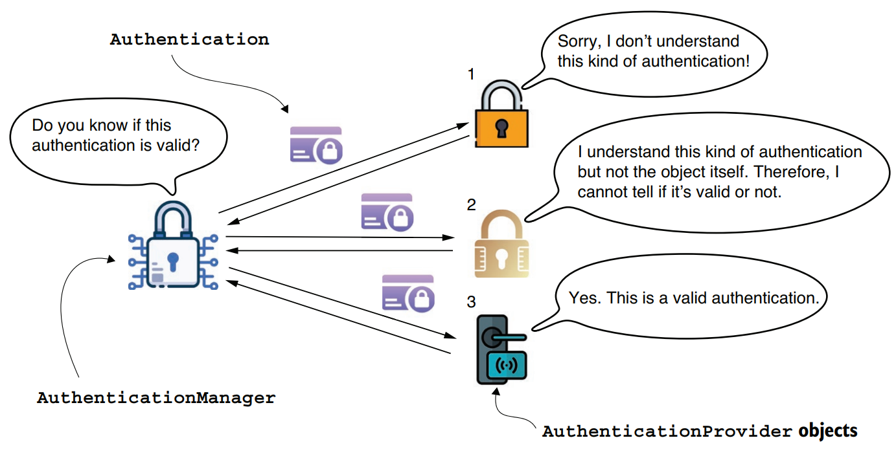
*(`AuthenticationManager` asking providers in turn; one finally confirms the authentication is valid)*

If a provider recognizes the `Authentication` but decides it is **not valid**, the result is an `AuthenticationException` → **401 Unauthorized** in a web app.

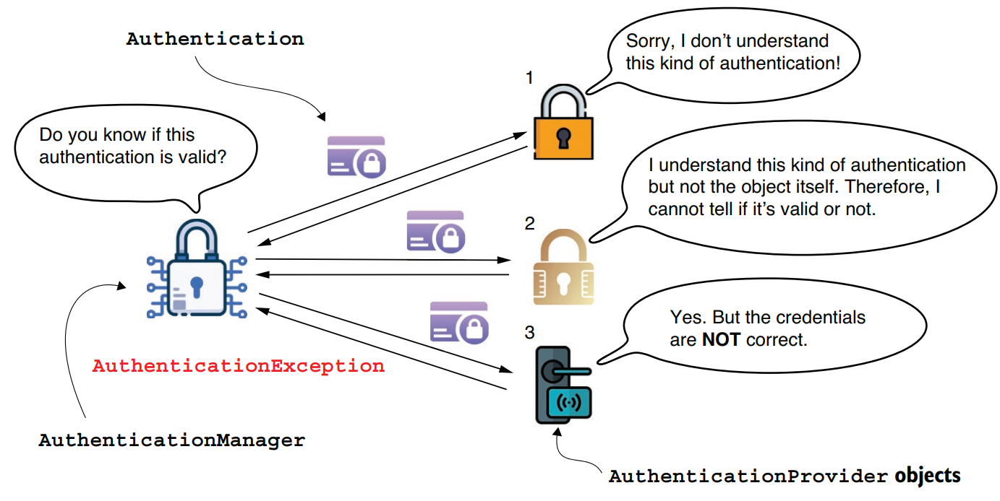
*(If no provider recognizes the `Authentication`, or one rejects it, the result is an `AuthenticationException`)*

---

### 2.3 Applying Custom Authentication Logic

Project: **`ssia-ch6-ex1`**

**Steps:**
1. Declare a class that implements the `AuthenticationProvider` contract.
2. Decide which kinds of `Authentication` objects the new provider supports.
3. Implement `supports(Class<?> c)` to specify the supported authentication type.
4. Implement `authenticate(Authentication a)` with the authentication logic.
5. Register an instance of the new provider with Spring Security.

> **NOTE** — The book says these steps are "also presented in figure 6.5", but the figure that illustrates the logic of the implementation is figure 6.6 (below); figure 6.5 shows the exception scenario. Treat the book's reference as a likely typo.

**Step 3 — `supports()`:**

```java
@Component
public class CustomAuthenticationProvider
  implements AuthenticationProvider {

  // Omitted code

  @Override
  public boolean supports(Class<?> authenticationType) {
    return authenticationType
      .equals(UsernamePasswordAuthenticationToken.class);   // ← only this type is supported
  }
}
```
*(Listing 6.3 — overriding `supports()`)*

- `@Component` puts an instance in the Spring-managed context.
- If nothing is customized at the authentication-filter level (chapter 5), the type is `UsernamePasswordAuthenticationToken`: an `Authentication` implementation representing a standard username + password request.
- This makes the provider support one specific kind of "key".

**Step 4 — `authenticate()`:**

```java
@Component
public class CustomAuthenticationProvider
  implements AuthenticationProvider {

  private final UserDetailsService userDetailsService;
  private final PasswordEncoder passwordEncoder;

  // Omitted constructor

  @Override
  public Authentication authenticate(Authentication authentication) {
    String username = authentication.getName();
    String password = authentication.getCredentials().toString();

    UserDetails u = userDetailsService.loadUserByUsername(username);

    if (passwordEncoder.matches(password, u.getPassword())) {
      return new UsernamePasswordAuthenticationToken(   // ← password matches: return Authentication with details
        username,
        password,
        u.getAuthorities());
    } else {
      throw new BadCredentialsException                 // ← BadCredentialsException inherits from AuthenticationException
        ("Something went wrong!");
    }
  }

  // Omitted code
}
```
*(Listing 6.4 — implementing the authentication logic)*

**Logic:**
- Load the user with the `UserDetailsService`.
- User doesn't exist → `loadUserByUsername()` should throw an `AuthenticationException`; the process stops and the HTTP filter sets **401**.
- User exists → check password with `matches()` of the `PasswordEncoder` from the context.
- Password doesn't match → throw `AuthenticationException` again.
- Password correct → return an `Authentication` marked "authenticated", containing the request details.

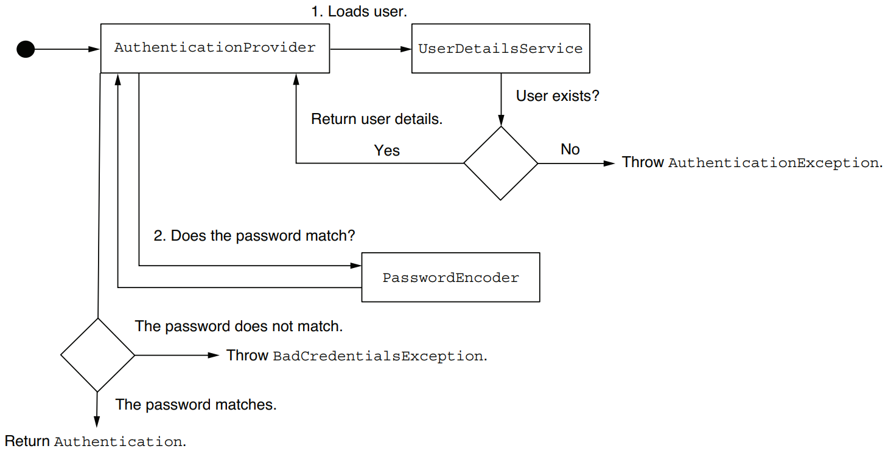
*(Flow of the custom provider: load user, check password, return `Authentication` or throw exception)*

**Step 5 — registering the provider** via a `SecurityFilterChain` bean:

```java
@Configuration
public class ProjectConfig {

  private final AuthenticationProvider authenticationProvider;

  // Omitted constructor

  @Bean
  public SecurityFilterChain securityFilterChain(HttpSecurity http)
    throws Exception {

    http.httpBasic(Customizer.withDefaults());
    http.authenticationProvider(authenticationProvider);   // ← register the custom provider
    http.authorizeHttpRequests(c -> c.anyRequest().authenticated());

    return http.build();
  }

  // Omitted code
}
```
*(Listing 6.5 — registering the `AuthenticationProvider` in the configuration class)*

> **NOTE** — The field is declared with the `AuthenticationProvider` **interface** (an abstraction). Spring finds the implementation in its context: here the only one, `CustomAuthenticationProvider`, added via `@Component`. (The author recommends his book *Spring Start Here* (Manning, 2021) for a dependency injection refresher.)

You have now customized the `AuthenticationProvider` and can customize authentication logic wherever you need it.

---

### ⚠️ Important: How to Fail in Application Design

**Story:** a consultant was called to a company to add a custom authentication method to a component built with early Spring.
- Developers hadn't relied on Spring Security's backbone architecture; they used **only the filter chain** and re-implemented whole Spring Security features as custom code.
- Customizations became harder over time; a lead developer blamed Spring Security ("hard to apply, hard to customize").
- Investigation showed they used perhaps **~10%** of what Spring Security offers.
- Outcome: a two-day workshop, then a decision to rewrite much custom code to use Spring Security correctly. (Other, unrelated problems were found too.)

**Lessons:**
- A widely used framework is written by many smart people; analyze your own app before blaming the framework.
- Understand at least the **basics** before choosing a framework.
- Be mindful of learning resources; web articles often show quick workarounds, not correct class design.
- Use **multiple sources**; when unsure, write a proof of concept.
- Use a framework for its intended purpose. If you write more custom security code than you rely on the framework, ask why.

**Benefits of relying on framework functionality:**
- ✅ Tested, so fewer chances of vulnerabilities
- ✅ Good frameworks rely on abstractions → more maintainable apps
- ❌ Your own implementations are more susceptible to vulnerabilities

---

## 3. Using the SecurityContext

This section covers how the security context works, how to access its data, and how the app manages it in different thread-related scenarios. The data stored here is used for authorization in chapters 7 and 8.

**Why it matters:** after authentication you often need the username or authorities of the current user. Once the `AuthenticationManager` completes authentication successfully, it **stores the `Authentication` instance for the rest of the request**. The instance holding the `Authentication` is the **security context**.

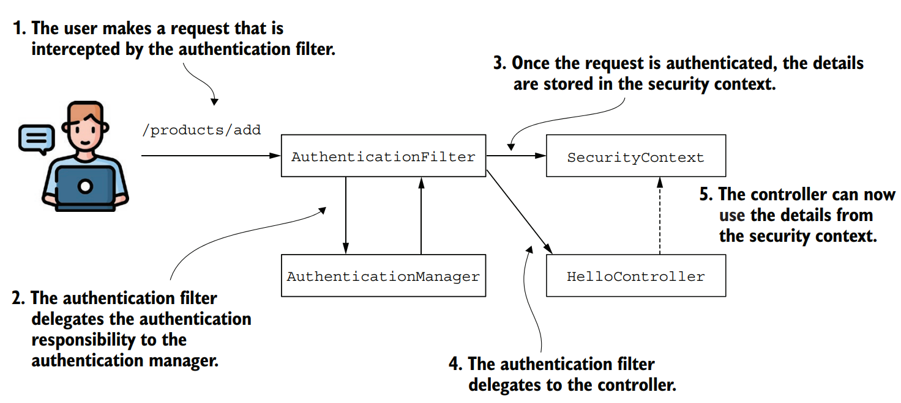
*(After successful authentication, the filter stores the entity's details in the security context; the controller can then read them)*

```java
public interface SecurityContext extends Serializable {
  Authentication getAuthentication();
  void setAuthentication(Authentication authentication);
}
```
*(Listing 6.6 — the `SecurityContext` interface)*

The primary job of `SecurityContext` is storing the `Authentication` object. The `SecurityContext` itself is managed by an object named **`SecurityContextHolder`**, which offers **three strategies**:

| Strategy | Behavior |
|---|---|
| `MODE_THREADLOCAL` | Each thread stores its own details in the security context. Common in thread-per-request web apps (each request has its own thread). **Default.** |
| `MODE_INHERITABLETHREADLOCAL` | Like `MODE_THREADLOCAL`, but also copies the security context to the next thread for an asynchronous method. The new thread running an `@Async` method inherits the context. (`@Async` makes Spring call the annotated method on a separate thread.) |
| `MODE_GLOBAL` | All threads of the application see the **same** security context instance. |

Beyond these three, the section also covers **threads you define yourself** that Spring doesn't know about: you must **explicitly copy** the details to the new thread. Spring Security can't manage objects outside Spring's context, but it offers great utility classes.

**Sub-sections:**
- 3.1 — `MODE_THREADLOCAL` (default)
- 3.2 — `MODE_INHERITABLETHREADLOCAL` (asynchronous calls)
- 3.3 — `MODE_GLOBAL` (standalone applications)
- 3.4 — `DelegatingSecurityContextRunnable` / `Callable` (self-managed threads)
- 3.5 — `DelegatingSecurityContextExecutorService` (self-managed threads)

---

### 3.1 Using a Holding Strategy for the Security Context

Project: **`ssia-ch6-ex2`**

`MODE_THREADLOCAL` is the **default** strategy.
- Uses the JDK's **`ThreadLocal`**: works like a collection, but each thread can only see data in its own dedicated part.
- No thread can access another thread's `ThreadLocal` → in a web app, each request sees only its own security context. This is generally what you want for a backend web app.

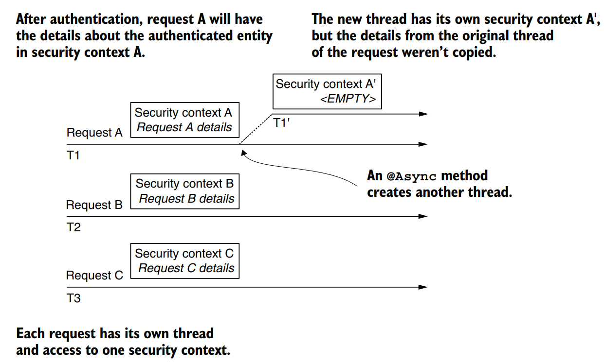
*(Requests A, B, C each have their own thread and context; an `@Async` method's new thread gets an empty context)*

⚠️ **Gotcha:** if a new thread is created (e.g. an asynchronous method call), it has its **own** security context, and the parent's details are **not copied**.

> **NOTE** — This discussion is for **traditional servlet apps** where each request is tied to its own thread. It does **not** apply to reactive apps (security for reactive approaches is covered in chapter 17).

No explicit configuration is needed (it is the default). Call the static `getContext()` wherever needed after authentication ends, then get the `Authentication`:

```java
@GetMapping("/hello")
public String hello() {
  SecurityContext context = SecurityContextHolder.getContext();
  Authentication a = context.getAuthentication();

  return "Hello, " + a.getName() + "!";
}
```
*(Listing 6.7 — obtaining the `SecurityContext` from the `SecurityContextHolder`)*

✅ **Better:** at the endpoint level, Spring injects the `Authentication` directly into the method parameter; no need to reference `SecurityContextHolder`.

```java
@GetMapping("/hello")
public String hello(Authentication a) {   // ← Spring Boot injects the current Authentication
  return "Hello, " + a.getName() + "!";
}
```
*(Listing 6.8 — Spring injects the `Authentication` value in the method parameter)*

**Test:**
```bash
curl -u user:99ff79e3-8ca0-401c-a396-0a8625ab3bad http://localhost:8080/hello
```
```
Hello, user!
```

---

### 3.2 Using a Holding Strategy for Asynchronous Calls

`MODE_THREADLOCAL` isolates the context per thread and is easy to reason about, but it breaks when there are **multiple threads per request**. Making an endpoint asynchronous means the thread that executes the method is no longer the thread serving the request.

```java
@GetMapping("/bye")
@Async   // ← being @Async, the method is executed on a separate thread
public void goodbye() {
  SecurityContext context = SecurityContextHolder.getContext();
  String username = context.getAuthentication().getName();

  // do something with the username
}
```
*(Listing 6.9 — an `@Async` method served by a different thread)*

To enable `@Async`, the example adds a configuration class annotated with `@EnableAsync`:

```java
@Configuration
@EnableAsync
public class ProjectConfig {
}
```

> **NOTE** — Articles and forums sometimes put configuration annotations (e.g. `@EnableAsync`) on the main class. That is technically correct because `@SpringBootApplication` includes the `@Configuration` characteristic. But in real apps, responsibilities are kept apart and the main class is never used as a configuration class. The book keeps annotations on a `@Configuration` class, as in practical scenarios.

⚠️ **Problem:** running this as-is throws a **`NullPointerException`** on `context.getAuthentication().getName()`. The method runs on another thread that does **not** inherit the security context, so the authentication is `null`.

> **NOTE** — The book says "the `Authorization` object is null" here; it means the `Authentication` object.

✅ **Fix:** use `MODE_INHERITABLETHREADLOCAL`. Set it either by:
- calling `SecurityContextHolder.setStrategyName()`, or
- the system property `spring.security.strategy`

The framework then copies the details of the request's original thread to the new asynchronous thread's context.

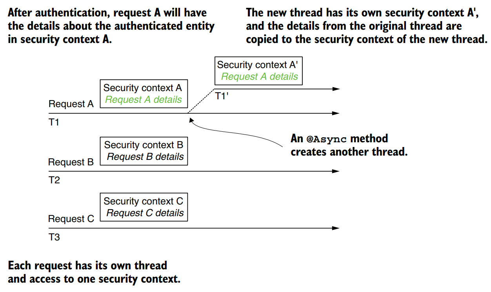
*(With `MODE_INHERITABLETHREADLOCAL`, the original thread's context details are copied to the new thread's context)*

```java
@Configuration
@EnableAsync
public class ProjectConfig {

  @Bean
  public InitializingBean initializingBean() {
    return () -> SecurityContextHolder.setStrategyName(
      SecurityContextHolder.MODE_INHERITABLETHREADLOCAL);   // ← switch strategy at startup
  }
}
```
*(Listing 6.10 — using `InitializingBean` to set the `SecurityContextHolder` mode)*

After calling the endpoint, the context is propagated correctly and `Authentication` is no longer `null`.

> **NOTE** — This works **only when the framework creates the thread itself** (e.g. an `@Async` method). If **your code** creates the thread, the same problem occurs even with `MODE_INHERITABLETHREADLOCAL`, because the framework doesn't know about that thread. These cases are solved in sections 3.4 and 3.5.

---

### 3.3 Using a Holding Strategy for Standalone Applications

Need a security context **shared by all threads**? Change the strategy to `MODE_GLOBAL`.
- ❌ Not for a web server: a backend web app handles requests independently, so one context **per request** makes more sense.
- ✅ Can be a good fit for a **standalone application**.

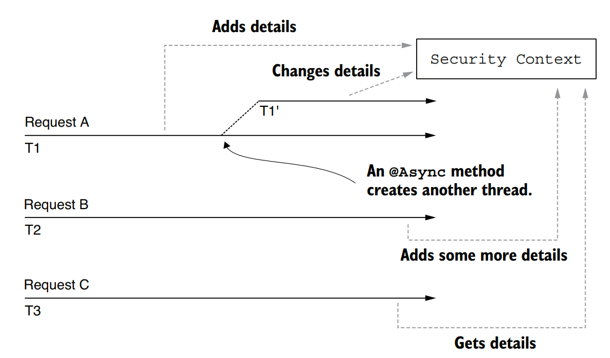
*(With `MODE_GLOBAL`, all threads access the same security context and can add or change details)*

Change it like the previous strategy (method `SecurityContextHolder.setStrategyName()` or system property `spring.security.strategy`):

```java
@Bean
public InitializingBean initializingBean() {
  return () -> SecurityContextHolder.setStrategyName(
    SecurityContextHolder.MODE_GLOBAL);
}
```

### ⚠️ Important: `SecurityContext` Is Not Thread-Safe

- With `MODE_GLOBAL`, all threads access the same data and can change it.
- Race conditions can occur → you must handle **synchronization / concurrent access** yourself.

---

### 3.4 Forwarding the Security Context with DelegatingSecurityContextRunnable

**Recap:**
- By default the framework only provides a security context for the **request thread**, accessible only to that thread.
- It doesn't handle newly created threads (e.g. asynchronous methods); for those you set a different mode (see 3.2).
- Remaining gap: what if **your code starts new threads** without the framework knowing? These are called **self-managed threads** (you manage them, not the framework).

> **NOTE** — In the book's recap of this section, the second mode is written `MODE_INHERITEDTHREADLOCAL`. The actual constant used everywhere else in the chapter is `MODE_INHERITABLETHREADLOCAL`.

No `SecurityContextHolder` strategy solves self-managed threads; you must take care of propagation. **Solution 1 — decorate the task:**

- **`DelegatingSecurityContextRunnable`** extends `Runnable`; use it when **no value is expected** after the task.
- **`DelegatingSecurityContextCallable<T>`** is the `Callable<T>` alternative; use it when there **is a return value**.
- Both represent tasks executed asynchronously like any other `Runnable`/`Callable`, and both **copy the current security context** for the thread that executes the task.

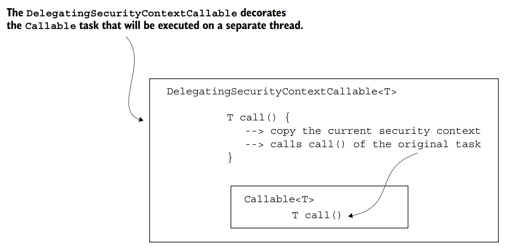
*(`DelegatingSecurityContextCallable` decorates the original `Callable`: it copies the context, then calls the original task)*

**Example, step 1 — define the `Callable` that returns the username from the current context:**

```java
@GetMapping("/ciao")
public String ciao() throws Exception {
  Callable<String> task = () -> {
    SecurityContext context = SecurityContextHolder.getContext();
    return context.getAuthentication().getName();
  };

  // Omitted code
}
```
*(Listing 6.11 — defining a `Callable` object to execute as a task on a separate thread)*

**Step 2 — submit the task to an `ExecutorService`** and return the result as the response body:

```java
@GetMapping("/ciao")
public String ciao() throws Exception {
  Callable<String> task = () -> {
    SecurityContext context = SecurityContextHolder.getContext();
    return context.getAuthentication().getName();
  };

  ExecutorService e = Executors.newCachedThreadPool();
  try {
    return "Ciao, " + e.submit(task).get() + "!";
  } finally {
    e.shutdown();
  }
}
```
*(Listing 6.12 — defining an `ExecutorService` and submitting the task)*

⚠️ Running this gives a `NullPointerException`: in the new thread the authentication doesn't exist and the security context is empty.

**Step 3 — decorate the task** with `DelegatingSecurityContextCallable` so the current context is provided to the new thread:

```java
@GetMapping("/ciao")
public String ciao() throws Exception {
  Callable<String> task = () -> {
    SecurityContext context = SecurityContextHolder.getContext();
    return context.getAuthentication().getName();
  };

  ExecutorService e = Executors.newCachedThreadPool();
  try {
    var contextTask = new DelegatingSecurityContextCallable<>(task);   // ← decorate the task
    return "Ciao, " + e.submit(contextTask).get() + "!";
  } finally {
    e.shutdown();
  }
}
```
*(Listing 6.13 — running the task decorated by `DelegatingSecurityContextCallable`)*

**Test:**
```bash
curl -u user:2eb3f2e8-debd-420c-9680-48159b2ff905 http://localhost:8080/ciao
```
```
Ciao, user!
```

---

### 3.5 Forwarding the Security Context with DelegatingSecurityContextExecutorService

**Second option** for self-managed threads: manage propagation from the **thread pool** instead of from the **task**.

- The task stays a plain `Callable<T>`.
- `DelegatingSecurityContextExecutorService` **decorates the `ExecutorService`** and handles propagation: it copies the security context details, then submits the task to the thread pool.

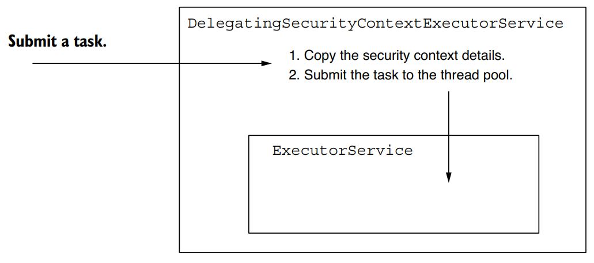
*(`DelegatingSecurityContextExecutorService` copies the context details, then submits the task to the thread pool)*

```java
@GetMapping("/hola")
public String hola() throws Exception {
  Callable<String> task = () -> {
    SecurityContext context = SecurityContextHolder.getContext();
    return context.getAuthentication().getName();
  };

  ExecutorService e = Executors.newCachedThreadPool();
  e = new DelegatingSecurityContextExecutorService(e);   // ← decorate the executor, not the task
  try {
    return "Hola, " + e.submit(task).get() + "!";
  } finally {
    e.shutdown();
  }
}
```
*(Listing 6.14 — propagating the `SecurityContext`)*

**Test:**
```bash
curl -u user:5a5124cc-060d-40b1-8aad-753d3da28dca http://localhost:8080/hola
```
```
Hola, user!
```

**Other variants:**
- Section 3.4 used `DelegatingSecurityContextCallable`; this section uses `DelegatingSecurityContextExecutorService`.
- **Scheduled tasks** → `DelegatingSecurityContextScheduledExecutorService`: same mechanism, but decorates a `ScheduledExecutorService`.
- **More flexibility** → `DelegatingSecurityContextExecutor`: decorates an `Executor`, the most abstract contract of the thread-pool hierarchy. Choose it when you want to be able to replace the thread-pool implementation with any of the language's choices.

> **NOTE** — Keep in mind the concurrency-support classes in the table below.

| Class | Description |
|---|---|
| `DelegatingSecurityContextExecutor` | Implements `Executor`; decorates an `Executor` with the ability to forward the security context to threads created by its pool |
| `DelegatingSecurityContextExecutorService` | Implements `ExecutorService`; decorates an `ExecutorService` with the ability to forward the security context to threads created by its pool |
| `DelegatingSecurityContextScheduledExecutorService` | Implements `ScheduledExecutorService`; decorates a `ScheduledExecutorService` with the ability to forward the security context to threads created by its pool |
| `DelegatingSecurityContextRunnable` | Implements `Runnable`; a task executed on a different thread **without** returning a response. On top of a normal `Runnable`, it propagates a security context to the new thread |
| `DelegatingSecurityContextCallable` | Implements `Callable`; a task executed on a different thread that **will return** a response. On top of a normal `Callable`, it propagates a security context to the new thread |

*(Table 6.1 — objects responsible for delegating the security context to a separate thread)*

---

## 4. Understanding HTTP Basic and Form-Based Login Authentications

So far only **HTTP Basic** has been used. It is simple, which makes it an excellent choice for **examples, demos, and proofs of concept**. For the same reason, it may not fit all real-world scenarios.

This section covers:
- More configuration of HTTP Basic
- A new method, **`formLogin`**

Other authentication methods that fit different architectures are covered later in the book, and compared so you can see best practices and anti-patterns.

---

### 4.1 Using and Configuring HTTP Basic

Project: **`ssia-ch6-ex3`**

HTTP Basic is the **default** authentication method (seen in chapter 3 examples). Defaults are great for theoretical scenarios; in a more complex app you may need to customize, for example:
- specific logic when authentication **fails**
- values set on the **response** sent to the client in that case

Setting the method explicitly:

```java
@Configuration
public class ProjectConfig {

  @Bean
  public SecurityFilterChain configure(HttpSecurity http)
    throws Exception {

    http.httpBasic(Customizer.withDefaults());
    return http.build();
  }
}
```
*(Listing 6.15 — setting the HTTP Basic authentication method)*

**Realm name:**
- Call `httpBasic()` with a `Customizer` parameter to configure the method, e.g. the **realm name**.
- A **realm** = a protection space that uses a specific authentication method (see RFC 2617: https://tools.ietf.org/html/rfc2617).

```java
@Bean
public SecurityFilterChain configure(HttpSecurity http)
  throws Exception {

  http.httpBasic(c -> {
    c.realmName("OTHER");                                  // ← rename the realm
    c.authenticationEntryPoint(new CustomEntryPoint());    // ← custom failure response (see below)
  });

  http.authorizeHttpRequests(c -> c.anyRequest().authenticated());
  return http.build();
}
```
*(Listing 6.16 — configuring the realm name for the response of failed authentications)*

- The lambda is actually a `Customizer<HttpBasicConfigurer<HttpSecurity>>`; the `HttpBasicConfigurer<HttpSecurity>` parameter lets you call `realmName()`.
- Use cURL with `-v` to see the changed realm.
- ⚠️ The `WWW-Authenticate` header appears **only on 401 Unauthorized**, not on 200 OK.

```bash
curl -v http://localhost:8080/hello
```
```
...
< WWW-Authenticate: Basic realm="OTHER"
...
```

**Customizing the failed-authentication response** (use a `Customizer`) — needed when the client expects something specific. You might:
- add or remove headers
- filter the body so no sensitive data is exposed

> **NOTE** — Always be careful about data exposed outside the system. Exposing sensitive data is one of the most common mistakes and is part of the **OWASP top ten** (https://owasp.org/www-project-top-ten/). What the app sends back on failed authentication is always a point of risk.

**How:** implement an **`AuthenticationEntryPoint`**. Its `commence()` method receives the `HttpServletRequest`, the `HttpServletResponse`, and the `AuthenticationException` that caused the failure.

> **NOTE** — The name `AuthenticationEntryPoint` is a bit ambiguous: it doesn't reflect its use on authentication failure. In the architecture it is used directly by a component the book calls `ExceptionTranslationManager`, which handles any `AccessDeniedException` and `AuthenticationException` thrown in the filter chain (a "bridge between Java exceptions and HTTP responses"). The component name is given as in the book; verify it against the Spring Security version you use.

```java
public class CustomEntryPoint
  implements AuthenticationEntryPoint {

  @Override
  public void commence(
    HttpServletRequest httpServletRequest,
    HttpServletResponse httpServletResponse,
    AuthenticationException e)
    throws IOException, ServletException {

    httpServletResponse
      .addHeader("message", "Luke, I am your father!");   // ← custom header
    httpServletResponse
      .sendError(HttpStatus.UNAUTHORIZED.value());        // ← 401
  }
}
```
*(Listing 6.17 — implementing an `AuthenticationEntryPoint`)*

Register it with the HTTP Basic method in the configuration class:

```java
@Bean
public SecurityFilterChain configure(HttpSecurity http)
  throws Exception {

  http.httpBasic(c -> {
    c.realmName("OTHER");
    c.authenticationEntryPoint(new CustomEntryPoint());
  });

  http.authorizeHttpRequests().anyRequest().authenticated();
  return http.build();
}
```
*(Listing 6.18 — setting the custom `AuthenticationEntryPoint`)*

> **NOTE** — Listing 6.18 uses `http.authorizeHttpRequests().anyRequest().authenticated()` (no lambda), while the other listings use `authorizeHttpRequests(c -> c.anyRequest().authenticated())`. The book's listing is reproduced as printed; the lambda form is the one used elsewhere in the chapter.

A failing call now shows the new header:

```bash
curl -v http://localhost:8080/hello
```
```
...
< HTTP/1.1 401
< Set-Cookie: JSESSIONID=459BAFA7E0E6246A463AD19B07569C7B; Path=/; HttpOnly
< message: Luke, I am your father!
...
```

---

### 4.2 Implementing Authentication with Form-Based Login

Project: **`ssia-ch6-ex4`**

For a web app you probably want a **user-friendly login form**, and for authenticated users to be able to browse pages after login and **log out**. For a small web app, use the form-based login method. The section builds a small web app with this flow.

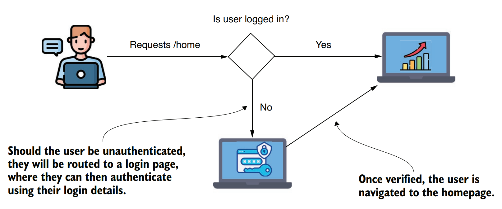
*(Form-based login flow: unauthenticated user is sent to a login form, then to the homepage after verification)*

> **NOTE** — Form-based login is linked to a **small web app** because it uses a **server-side session** to manage the security context. For larger apps needing **horizontal scalability**, a server-side session for the security context is **undesirable** (discussed in chapters 12 through 15 with OAuth 2).

**Switching the method:** instead of `httpBasic()`, call `formLogin()` on the `HttpSecurity` parameter.

```java
@Configuration
public class ProjectConfig {

  @Bean
  public SecurityFilterChain securityFilterChain(HttpSecurity http)
    throws Exception {

    http.formLogin(Customizer.withDefaults());   // ← replaces httpBasic()

    http.authorizeHttpRequests(c -> c.anyRequest().authenticated());

    return http.build();
  }
}
```
*(Listing 6.19 — changing the authentication method to a form-based login)*

Even this minimal configuration gives you an auto-configured **login form** and a **log-out page**. Accessing the app in a browser redirects you to the login page.

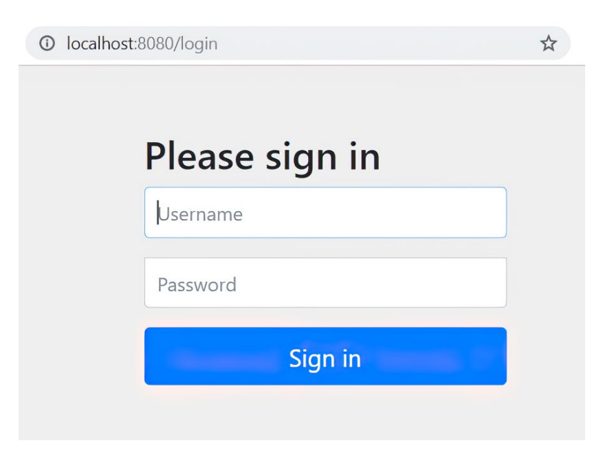
*(The default login page auto-configured by `formLogin()`)*

**Login credentials:**
- If you haven't registered your own `UserDetailsService`, use the defaults (chapter 2): username `user` and the **UUID password printed in the console** at startup.
- With no other page defined, a successful login redirects you to a **default error page**.
- The authentication architecture is the same as in earlier examples.
- The difference: instead of a JSON response, the endpoint should return **HTML** the browser interprets as a web page → stick to the **Spring MVC flow** and render the view from a file after the controller action runs.

> **NOTE** — At this point the book says "as shown in figure 6.14, you need to implement a controller for the application homepage". Figure 6.14 is the login page; the MVC flow is in figure 6.15. Likely a mis-reference in the book.

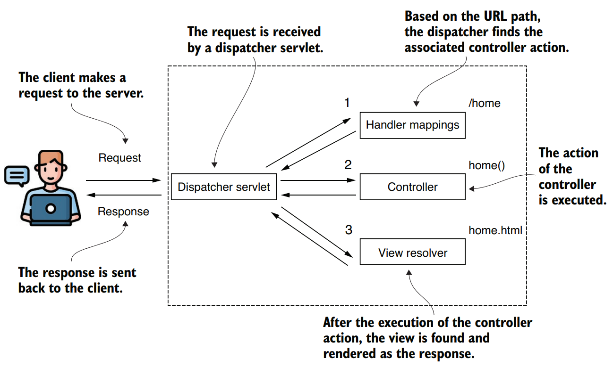
*(Spring MVC flow: dispatcher servlet → handler mappings → controller → view resolver → response)*

**Adding a simple page:**
1. Create an HTML file in the `resources/static` folder; the book calls it `home.html`.
2. Add some text (e.g. a heading: `<h1>Welcome</h1>`).
3. Define a controller mapping from the path to the view.

```java
@Controller
public class HelloController {

  @GetMapping("/home")
  public String home() {
    return "home.html";
  }
}
```
*(Listing 6.20 — action method of the controller for the `home.html` page)*

⚠️ It is a plain **`@Controller`**, not a `@RestController`. Spring therefore doesn't send the returned value in the HTTP response; it finds and **renders the view** named `home.html`.

**Behavior now:**
- Accessing `/home` → first asked to log in; after login, redirected to the homepage with the welcome message.
- Accessing `/logout` → redirected to a log-out page.


*(The log-out page configured by Spring Security for form-based login)*

**Redirect rules:**
- Trying a path without being logged in → automatically redirected to the login page.
- After successful login → redirected back to the path originally requested.
- If that path doesn't exist → default error page.

**Customizing:** `formLogin()` returns a `FormLoginConfigurer<HttpSecurity>`, which allows customizations such as `defaultSuccessUrl()`:

```java
@Bean
public SecurityFilterChain securityFilterChain(HttpSecurity http)
  throws Exception {

  http.formLogin(c -> c.defaultSuccessUrl("/home", true));

  http.authorizeHttpRequests(c -> c.anyRequest().authenticated());

  return http.build();
}
```
*(Listing 6.21 — setting a default success URL for the login form)*

**Deeper customization:** `AuthenticationSuccessHandler` and `AuthenticationFailureHandler` let you implement the logic executed on success or failure.

#### AuthenticationSuccessHandler

- `onAuthenticationSuccess()` receives the servlet request, servlet response, and the `Authentication` object.
- Example: different redirects depending on the granted authorities of the logged-in user.

```java
@Component
public class CustomAuthenticationSuccessHandler
  implements AuthenticationSuccessHandler {

  @Override
  public void onAuthenticationSuccess(
    HttpServletRequest httpServletRequest,
    HttpServletResponse httpServletResponse,
    Authentication authentication)
    throws IOException {

    var authorities = authentication.getAuthorities();

    var auth =
      authorities.stream()
        .filter(a -> a.getAuthority().equals("read"))
        .findFirst();                                     // ← empty Optional if "read" authority doesn't exist

    if (auth.isPresent()) {
      httpServletResponse
        .sendRedirect("/home");                           // ← "read" authority exists → /home
    } else {
      httpServletResponse
        .sendRedirect("/error");
    }
  }
}
```
*(Listing 6.22 — implementing an `AuthenticationSuccessHandler`)*

#### AuthenticationFailureHandler

Clients may expect a particular format on failed authentication:
- a different HTTP status than 401, or extra information in the body
- most typical case (per the author): a **request identifier**, a unique value to trace the request across systems, sent in the response body
- **sanitizing** the response so no sensitive data leaves the system
- simply **logging** the event for later investigation

Customize with an `AuthenticationFailureHandler` implementation. Example: add a specific header on any failed authentication (any logic could go here).

```java
@Component
public class CustomAuthenticationFailureHandler
  implements AuthenticationFailureHandler {

  @Override
  public void onAuthenticationFailure(
    HttpServletRequest httpServletRequest,
    HttpServletResponse httpServletResponse,
    AuthenticationException e) {

    try {
      httpServletResponse.setHeader("failed",
        LocalDateTime.now().toString());               // ← custom "failed" header with timestamp
      httpServletResponse.sendRedirect("/error");

    } catch (IOException ex) {
      throw new RuntimeException(ex);
    }
  }
}
```
*(Listing 6.23 — implementing an `AuthenticationFailureHandler`)*

> **NOTE** — The book's text says `onAuthenticationFailure()` receives "the request, response, and the `Authentication` object", but the code in the listing receives an `AuthenticationException` as the third parameter. The listing is reproduced as printed.

#### Registering both handlers

Register them on the `FormLoginConfigurer` returned by `formLogin()`:

```java
@Configuration
public class ProjectConfig {

  private final CustomAuthenticationSuccessHandler
    authenticationSuccessHandler;
  private final CustomAuthenticationFailureHandler
    authenticationFailureHandler;

  // Omitted constructor

  @Bean
  public UserDetailsService uds() {
    var uds = new InMemoryUserDetailsManager();

    uds.createUser(
      User.withDefaultPasswordEncoder()
        .username("john")
        .password("12345")
        .authorities("read")
        .build()
    );

    uds.createUser(
      User.withDefaultPasswordEncoder()
        .username("bill")
        .password("12345")
        .authorities("write")
        .build()
    );

    return uds;
  }

  @Bean
  public SecurityFilterChain configure(HttpSecurity http)
    throws Exception {

    http.formLogin(c ->
      c.successHandler(authenticationSuccessHandler)    // ← register handlers
       .failureHandler(authenticationFailureHandler)
    );

    http.authorizeHttpRequests(c -> c.anyRequest().authenticated());

    return http.build();
  }
}
```
*(Listing 6.24 — registering the handler objects in the configuration class)*

⚠️ **Gotcha — HTTP Basic no longer works with only `formLogin`:** calling `/home` with HTTP Basic and the right username/password returns **HTTP 302 Found** (a redirect). The app ignores the provided credentials and tries to send you to the login form, as requested by `formLogin`.

✅ **Fix:** configure both methods together:

```java
@Bean
public SecurityFilterChain securityFilterChain(HttpSecurity http)
  throws Exception {

  http.formLogin(c ->
    c.successHandler(authenticationSuccessHandler)
     .failureHandler(authenticationFailureHandler)
  );

  http.httpBasic(Customizer.withDefaults());   // ← HTTP Basic alongside formLogin

  http.authorizeHttpRequests(c -> c.anyRequest().authenticated());

  return http.build();
}
```
*(Listing 6.25 — using form-based login and HTTP Basic together)*

`/home` now works with both methods:

```bash
curl -u user:cdd430f6-8ebc-49a6-9769-b0f3ce571d19 http://localhost:8080/home
```
```
<h1>Welcome</h1>
```

---

## 5. Summary of All Approaches

| Approach | Syntax / Tool | When to use |
|---|---|---|
| Custom authentication logic | `AuthenticationProvider` with `authenticate()` + `supports()`, registered via `http.authenticationProvider(...)` | Default username/password logic doesn't fit; keep user lookup in `UserDetailsService` and password check in `PasswordEncoder` |
| Read the current user (manual) | `SecurityContextHolder.getContext().getAuthentication()` | Anywhere you need the authenticated entity |
| Read the current user (injected) | `public String hello(Authentication a)` | Preferred at the endpoint level |
| Default context strategy | `MODE_THREADLOCAL` | Thread-per-request web apps; each request sees only its own context |
| Context for `@Async` threads | `MODE_INHERITABLETHREADLOCAL` via `SecurityContextHolder.setStrategyName()` or `spring.security.strategy` | Threads created by the **framework** (e.g. `@Async`) |
| One shared context | `MODE_GLOBAL` | **Standalone** apps only; handle synchronization yourself; not for web servers |
| Self-managed thread, decorate the task | `DelegatingSecurityContextRunnable` / `DelegatingSecurityContextCallable` | Your code starts the thread; propagate context per task |
| Self-managed thread, decorate the pool | `DelegatingSecurityContextExecutor` / `...ExecutorService` / `...ScheduledExecutorService` | Your code starts the threads; propagate context per thread pool |
| HTTP Basic | `http.httpBasic(Customizer.withDefaults())` | Demos, proofs of concept, simple cases |
| HTTP Basic customization | `c.realmName("OTHER")`, `c.authenticationEntryPoint(new CustomEntryPoint())` | Custom realm or custom response on failed authentication |
| Form-based login | `http.formLogin(Customizer.withDefaults())` | Small web apps using a server-side session |
| Form login success target | `c.defaultSuccessUrl("/home", true)` | Fixed redirect after login |
| Form login custom handlers | `c.successHandler(...)`, `c.failureHandler(...)` | Logic on success (e.g. redirect by authority) or failure (headers, logging, request id, sanitizing) |
| Form login + HTTP Basic | `http.formLogin(...)` + `http.httpBasic(...)` | Support both browser form login and HTTP Basic clients |

**Chapter summary points:**
- The `AuthenticationProvider` lets you implement custom authentication logic.
- Keep responsibilities decoupled: it delegates user management to a `UserDetailsService` and password validation to a `PasswordEncoder`.
- The `SecurityContext` keeps details about the authenticated entity after successful authentication.
- Three strategies manage the context: `MODE_THREADLOCAL`, `MODE_INHERITABLETHREADLOCAL`, `MODE_GLOBAL`. Access from different threads works differently depending on the mode.
- ⚠️ The inheritable thread-local mode only applies to threads **managed by Spring**; the framework won't copy the context for threads it doesn't govern.
- For threads created by your code, use `DelegatingSecurityContextRunnable`, `DelegatingSecurityContextCallable`, or `DelegatingSecurityContextExecutor` (the chapter also covers the `ExecutorService` and `ScheduledExecutorService` variants in Table 6.1).
- `formLogin()` auto-configures a login form and a log-out option; it is straightforward for small web apps, is highly customizable, and can be used together with HTTP Basic.

---

## Quick-Reference Summary

| Concept | One-liner |
|---|---|
| `AuthenticationProvider` | Component holding the authentication logic; `authenticate()` and `supports()` define it |
| `authenticate()` | Returns a fully authenticated `Authentication`, throws `AuthenticationException` on failure, returns `null` for an unsupported type |
| `supports(Class<?>)` | Says whether the provider handles a given `Authentication` type; `true` doesn't guarantee `authenticate()` will accept it |
| `Authentication` | Represents the authentication request event; extends `Principal`; holds name, credentials, authorities, details, authenticated flag |
| Principal | The user requesting access to the application |
| `UsernamePasswordAuthenticationToken` | Standard `Authentication` implementation for username + password requests |
| `BadCredentialsException` | Thrown on password mismatch; inherits from `AuthenticationException` |
| `SecurityContext` | Stores the `Authentication` of the current authenticated request |
| `SecurityContextHolder` | Manages the `SecurityContext` using one of three strategies |
| `MODE_THREADLOCAL` | Default; each thread (request) has its own context |
| `MODE_INHERITABLETHREADLOCAL` | Copies the context to threads created by the framework (e.g. `@Async`) |
| `MODE_GLOBAL` | All threads share one context; not thread-safe, so synchronize |
| `spring.security.strategy` | System property alternative to `setStrategyName()` |
| `@Async` / `@EnableAsync` | Run a method on a separate thread / enable that functionality |
| `DelegatingSecurityContextRunnable` | `Runnable` task decorator that propagates the context (no return value) |
| `DelegatingSecurityContextCallable<T>` | `Callable` task decorator that propagates the context (returns a value) |
| `DelegatingSecurityContextExecutorService` | Decorates an `ExecutorService` to propagate the context on submit |
| `DelegatingSecurityContextScheduledExecutorService` | Decorates a `ScheduledExecutorService` for scheduled tasks |
| `DelegatingSecurityContextExecutor` | Decorates the most abstract `Executor`; lets you swap thread-pool implementations |
| `httpBasic(Customizer)` | Configures HTTP Basic (e.g. realm name, entry point) |
| Realm | A protection space that uses a specific authentication method |
| `AuthenticationEntryPoint` / `commence()` | Customizes the response for a failed authentication |
| `formLogin()` | Form-based login; returns `FormLoginConfigurer<HttpSecurity>`; auto-configures login and log-out pages |
| `defaultSuccessUrl("/home", true)` | Fixed redirect after successful login |
| `AuthenticationSuccessHandler` | `onAuthenticationSuccess()` runs custom logic on successful authentication |
| `AuthenticationFailureHandler` | `onAuthenticationFailure()` runs custom logic on failed authentication |
| `@Controller` vs `@RestController` | `@Controller` returning a view name renders the view; it doesn't send the return value as the body |

---
